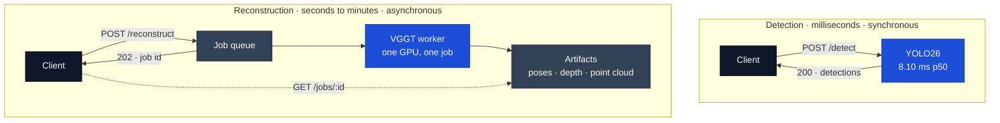

# Anastasios Kyriazis

**Solutions engineer** · BSc Digital Systems, University of Thessaly · Thessaloniki, Greece

I work at the boundary between what a customer needs and what a system should do: scoping the
problem, designing the shape of the answer, and building the proof of concept that removes the
risk from it.

[LinkedIn](https://linkedin.com/in/anastasios-kyriazis) &nbsp;·&nbsp;
[Stack Overflow](https://stackoverflow.com/users/22003274/akyriii) &nbsp;·&nbsp;
[akiriazis2@gmail.com](mailto:akiriazis2@gmail.com) &nbsp;·&nbsp;
open to remote work and relocation

---

## Selected work

| Project | Shape | The number that decided it |
|---|---|---|
| [Object detection service](https://github.com/Ankyriazis/yolo26-inference-service) | Synchronous REST | **8.10 ms** p50 on an RTX 4060 |
| [3D reconstruction service](https://github.com/Ankyriazis/vggt-reconstruction-service) | Asynchronous job queue | **10 MB** over budget turned 1.35 s into 71 s |
| [Sudoku recognition pipeline](https://github.com/Ankyriazis/ai_sudoku_solver) | Command-line pipeline | **81 / 81** cells read correctly |

### Two vision services, two contracts

Both run on the same GPU and are deliberately shaped differently. The workload dictates the
contract, and getting the contract wrong is not something a better implementation recovers from.

**[Object detection — synchronous](https://github.com/Ankyriazis/yolo26-inference-service).**
YOLO26 behind a FastAPI endpoint, with OpenCV 5 for decode and annotation. At 8.10 ms p50 and
99 images/second on an RTX 4060, a request/response shape fits comfortably. The interesting work
is around the model rather than in it: weights load once at startup with warmup inferences, so
the first caller does not absorb CUDA initialisation; uploads are decoded in memory rather than
through a temp file; and the ONNX export verifies itself by loading the graph back and running
it, because Ultralytics reports success as soon as a file exists. 22 tests, none needing a GPU.
 Python · FastAPI · YOLO26 · OpenCV 5 · ONNX Runtime · Docker

**[3D reconstruction from unposed images — asynchronous](https://github.com/Ankyriazis/vggt-reconstruction-service).**
VGGT recovers camera poses, depth and a point cloud from a handful of photographs with no
calibration step. A job takes anywhere from about a second to over two minutes, too long and too
unpredictable to hold a connection open, so the API accepts work with `202` and a job id, and
the client polls. The measurement that mattered was memory, not latency: on an 8 GB card, two
views need 6.95 GB while the desktop leaves 6.94 GB free. CUDA does not fail there; it pages to
host memory and carries on, so the same job ran in 1.35 s when it fitted and 71 s when it did
not, with nothing logged in between. The service now records its VRAM budget at startup and
reports the shortfall on `/readyz`, which turns a fiftyfold mystery into a line an operator can
act on.
 Python · FastAPI · VGGT · PyTorch · CUDA · Docker

Both also forced a licensing decision rather than a default one: the detector is AGPL-3.0
because Ultralytics is, and the reconstruction service is MIT over weights that are CC BY-NC,
which it depends on rather than redistributes. Knowing which checkpoint you are allowed to ship
is part of the design, not paperwork after it.

### [Sudoku recognition pipeline](https://github.com/Ankyriazis/ai_sudoku_solver)

Reading a puzzle from a phone photograph, where the solve is trivial and everything upstream is
not: perspective correction, cell segmentation, and character recognition that has to be right
81 times in a row. Recognition escalates only when it is unsure. It reads the sample image with
zero incorrect cells, and 13 tests cover the solver, the geometry and the error paths.
 Python · OpenCV · Tesseract

---

## Background

|  |  |
|---|---|
| **Education** | BSc, Department of Digital Systems — University of Thessaly |
| **Coursework** | Object-oriented design, data structures and algorithms, statistical analysis and probability, software engineering practice |
| **Languages** | Greek (native) · English (C2, ECPE — Michigan Language Assessment / Cambridge, 2020) |
| **Availability** | Open to relocation and to remote work · military service completed |

## Technical scope

| Area | |
|---|---|
| **Languages** | Python · Java · C++ · JavaScript · SQL |
| **Services and APIs** | FastAPI · REST · Postman · Newman CLI · REST Assured |
| **Deployment** | Docker · Docker Compose · CUDA · ONNX Runtime |
| **Vision and ML** | PyTorch · OpenCV 5 · YOLO26 · NumPy |
| **Web and mobile** | React · HTML · CSS · Flutter |
| **Platforms and practice** | Linux/Unix · Git · Agile · CI/CD |
